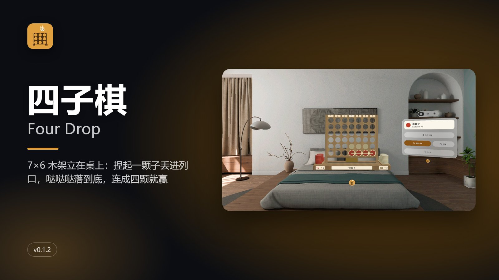
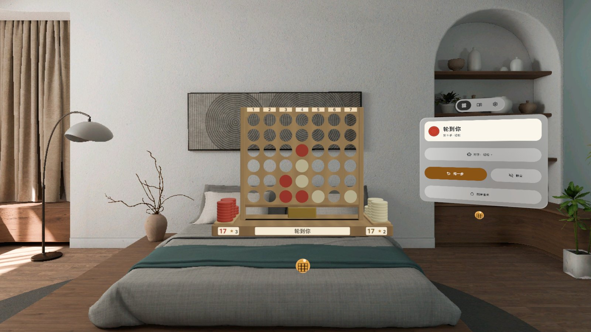
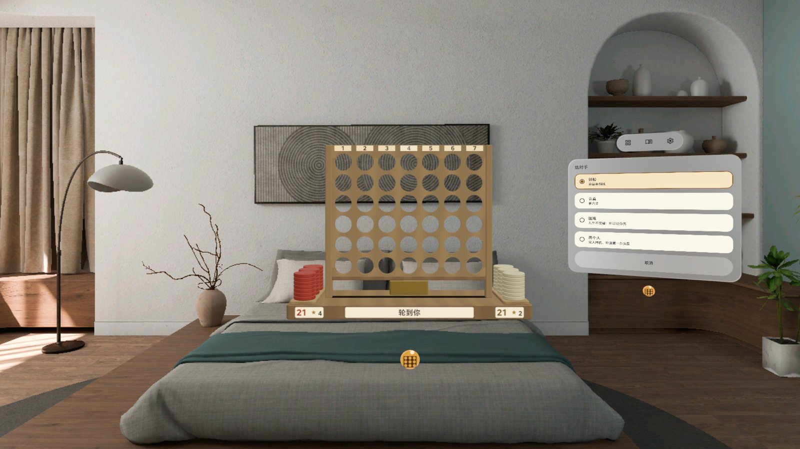
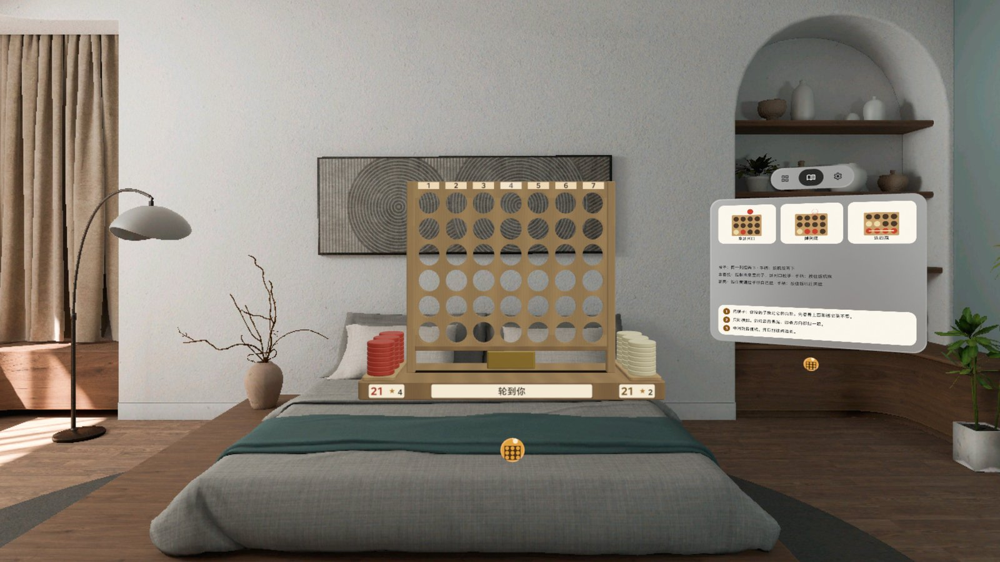
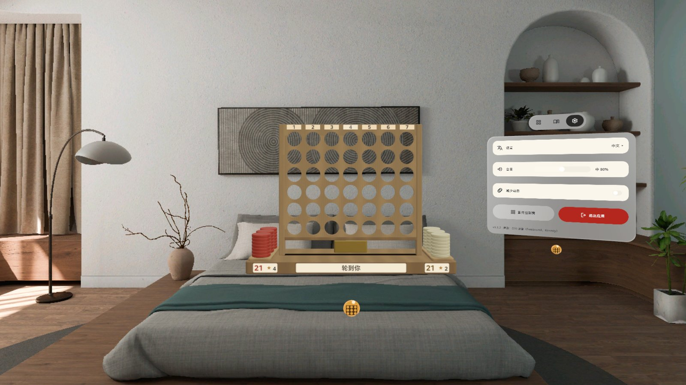

# 四子棋 · Four Drop



[中文](#中文) · [English](#english)

## 中文

一个 7 列 6 行的木头立架立在你桌上（PICO OS 6 Shared Space）。点一列再点一次，或者从托盘捏起一颗子拿到列口松手：它一行一声「哒」地掉到底。横、竖、斜连成四颗就赢。玩完把底板朝自己一拉，满盘的子倒出来，落回两边托盘。

- 对手：轻松（偶尔漏看斜线）、认真（往后看六步）、困难（位棋盘 α-β，几乎不失误，所以总是你先下），或者两个人轮流戴同一台头显。
- 悔一步、倒掉重来、静音、三档音量、减少动态、中文 / English。
- 全部本机运行：不联网、不需要账号，每一手自动保存。

| | |
|---|---|
|  |  |
| 终局：赢的四颗亮起光条，其余子保持本色 | 对局中：轮到你 |
|  |  |
| 对手在想 | 选对手：轻松 / 认真 / 困难 / 两个人 |
|  |  |
| 规则页 | 设置：语言、音量、减少动态、退出应用 |

截图和演示视频都在 PICO 模拟器里拍，由调试命令驱动，**不是真实手势录像**。

### 安装

从 [Releases](https://github.com/kejing-dev/FourDrop/releases) 下载 `FourDrop-v0.1.2.apk`，然后：

```bash
adb install -r FourDrop-v0.1.2.apk
pico-cli app launch io.embodit.fourdrop
```

Release 上的 APK 是 `assembleRelease` 出的未签名包，给 Vibe Lab 上架用（平台托管签名）。自己装到头显上请用下面的方法构建 debug 包。

## English

A wooden 7 × 6 rack stands on your table in PICO OS 6 Shared Space. Tap a column twice, or carry a disc from your
tray to a column mouth and let go: it rattles down to the bottom, one tick per row. Four in a row wins. Pull the
slide toward you and all the discs pour out and stack back into the trays.

- Opponents: Easy (misses diagonals), Serious (looks six moves ahead), Hard (bitboard α-β, hardly slips — so you go
  first), or two players passing one headset.
- Undo, dump and restart, mute, three volume stops, reduce motion, 中文 / English.
- Everything is local: no network, no account, every move is saved.

Screenshots and the demo video were captured on the PICO emulator, driven by debug commands. **They are not
recordings of real hand gestures.**

### Install

Download `FourDrop-v0.1.2.apk` from [Releases](https://github.com/kejing-dev/FourDrop/releases), then:

```bash
adb install -r FourDrop-v0.1.2.apk
pico-cli app launch io.embodit.fourdrop
```

The Release APK is the unsigned `assembleRelease` build for the Vibe Lab listing (the store signs it). To side-load
onto your own headset, build the debug APK as below.

## Build

```bash
./gradlew assembleDebug testDebugUnitTest
```

Spatial SDK BOM 6.1.9, minSdk 35. The rack, discs and trays are runtime meshes (exact hole and column sizes); the oak
grain is drawn procedurally. Icons: Material Symbols (Apache 2.0). Font: Noto Sans (OFL, `third_party/noto-sans`).

## Sounds

CC0 recordings: freesound 840425 (Hongsungbock, "baduk2") for the disc ticks, landing and pick-up; freesound 254343
(cmorris035, wood slide) for the slide; Kenney Interface Sounds for the full-column, win and lose cues.
